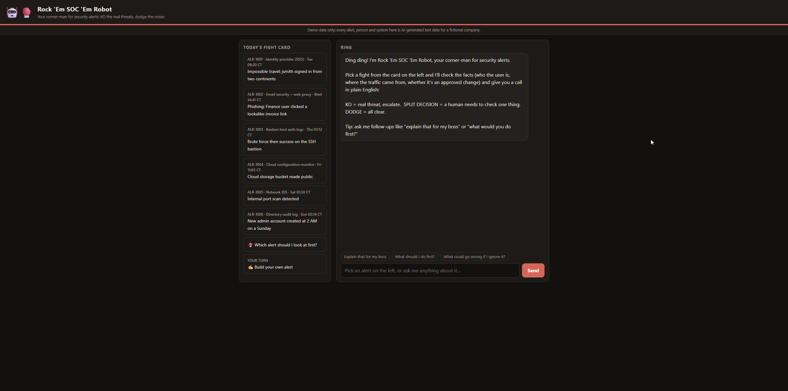
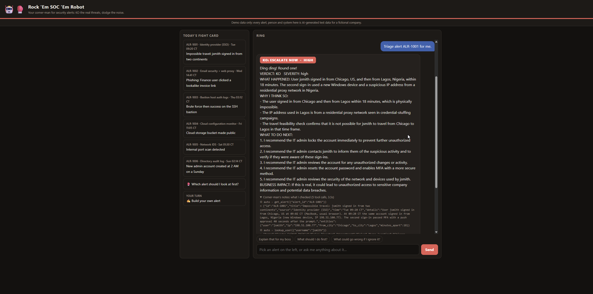
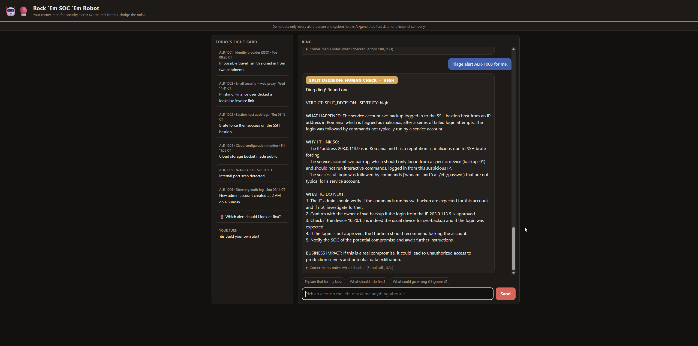
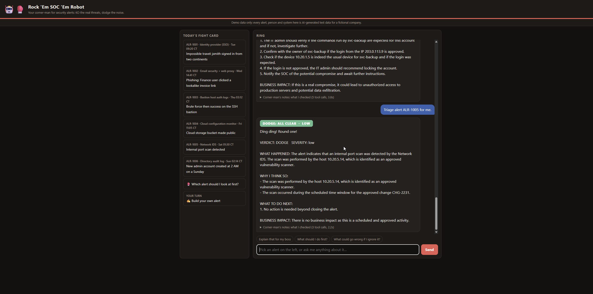
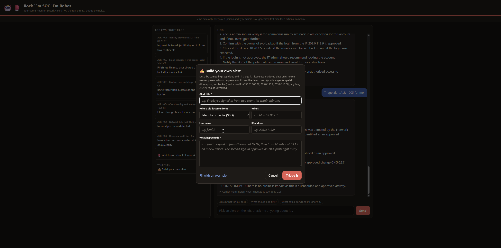
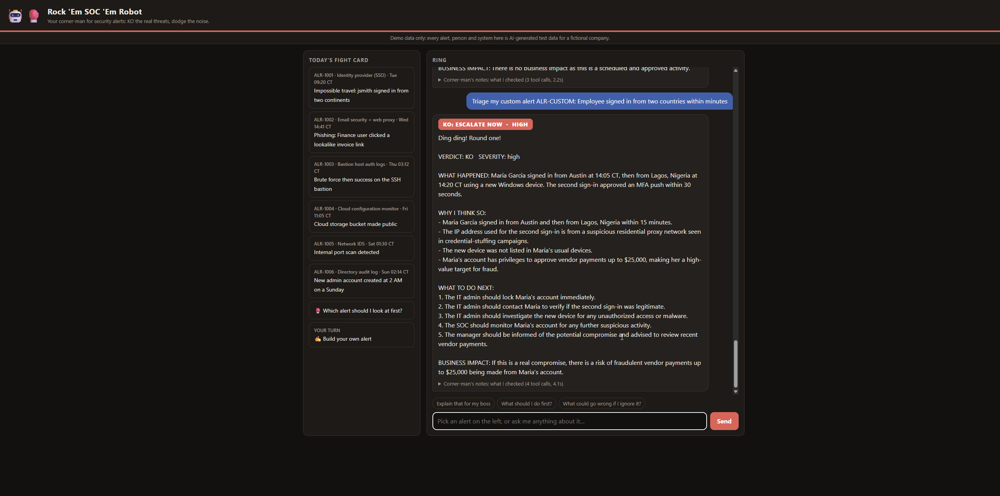
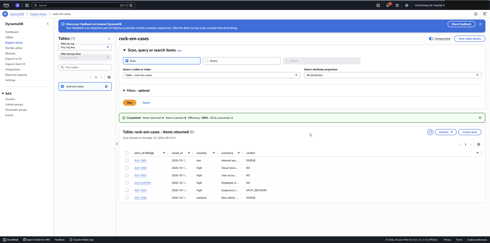
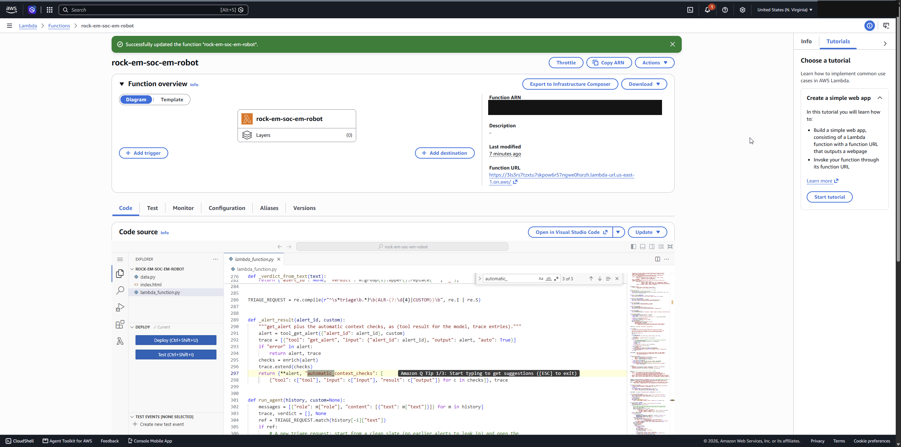

# 🤖🥊 SOC It To 'Em

An agentic **SOC analyst copilot** for a mid-size business, built for the
AWS Builder Center *Build an Agent Weekend Challenge*.

Security teams at ~200-person companies drown in alerts. Pick an alert from the "fight card"
and the robot investigates it with tools (user directory, asset inventory, threat intel,
travel-feasibility math), then calls it in plain English:

| Call | Meaning |
|---|---|
| 🔴 **KO** | Real threat, escalate now |
| 🟡 **SPLIT DECISION** | Suspicious, a human must check one specific thing |
| 🟢 **DODGE** | Benign or an approved activity, close it |

Every answer shows the verdict, severity, what happened (for a non-security manager), why, who
should do what next, and the business impact. A "Corner-man's notes" panel shows every tool the
agent called, so you can verify its reasoning.

> **The fight card is AI-generated test data.** The company, people, hosts and alerts are fictional,
> and IPs come from documentation ranges. Live bouts are real Amazon GuardDuty findings from the
> account the robot runs in (in the demo, GuardDuty's own sample findings), with account IDs redacted.

## 📡 New: live bouts from Amazon GuardDuty

The robot used to spar only with six made-up alerts. Its new tool, **`get_guardduty_findings`**
([`lambda/guardduty_tool.py`](lambda/guardduty_tool.py)), reads real findings from **Amazon GuardDuty**,
and an **Amazon EventBridge** rule wakes it for every new one. It triages each finding on its own,
with nobody at the keyboard, saves the KO / SPLIT DECISION / DODGE call to the case log, and shows it
under **Live bouts**. Account IDs and access keys are redacted before the model or the page sees them.
Set-up and a reusable-tool guide: [docs/GUARDDUTY.md](docs/GUARDDUTY.md). Try the tool without AWS in the
[quickstart notebook](notebooks/guardduty_tool_quickstart.ipynb). Demo video: https://www.youtube.com/watch?v=u9MZofCVn0s. The version before this tool
is commit [`613984e`](https://github.com/grand1llusion/rock-em-soc-em-robot/tree/613984e).

## Screenshots

*All alerts, people and systems shown are AI-generated test data.*

| | |
|---|---|
| **First run**: friendly welcome, one-click alerts | **KO**: impossible travel, with the "Corner-man's notes" showing every check |
|  |  |
| **SPLIT DECISION**: a human needs to check one thing | **DODGE**: approved scanner, cites change ticket CHG-2231 |
|  |  |
| **Build your own alert** (ghost-text examples in every field) | **Custom alert result** |
|  |  |
| **Case log in DynamoDB**: the agent saves its own verdicts | **Deployed on AWS Lambda** with a Function URL |
|  |  |

## Architecture

```
Browser ──HTTPS──> Lambda Function URL ──> AWS Lambda (Python)
                                              ├─ Amazon Bedrock (Nova, Converse API + tool use)
                                              ├─ Tools: list_alerts, get_alert, lookup_user,
                                              │         lookup_asset, check_ip,
                                              │         check_travel_feasibility, save_verdict
                                              └─ Amazon DynamoDB (case log of verdicts)
                                   CloudWatch Logs + AWS Budgets for monitoring and cost guard
```

One Lambda serves the web page (`GET /`), the alert queue (`GET /alerts`) and the agent (`POST /chat`).

## Experience touches

- Friendly first run: welcome message, one-click alerts, suggested follow-ups.
- Verdicts are color-coded boxing calls, with a plain-English "business impact" line.
- Helpful errors: content-filter blocks, throttling, and missing Bedrock access each get an
  in-character, actionable message instead of a stack trace.
- Transparent: every tool call is viewable.

## Deploy

See [docs/DEPLOY.md](docs/DEPLOY.md). Short version: upload `dist/rock-em-soc-em-robot.zip` to a
Lambda (Python 3.12+), set the execution role, create a DynamoDB table `rock-em-cases`
(partition key `alert_id`), enable a Function URL.

## Develop

```
pip install boto3
python -m unittest discover -s tests -v   # offline tests with a fake Bedrock client
python scripts/build_zip.py               # rebuild dist/rock-em-soc-em-robot.zip
```

Files: `lambda/lambda_function.py` (agent loop + tools + HTTP), `lambda/data.py` (synthetic
data), `lambda/index.html` (UI).
